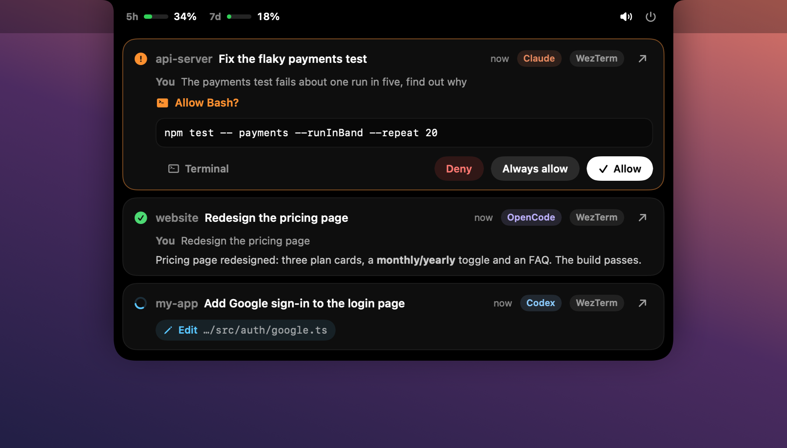

# Notch Island

**A Dynamic Island for your coding agents.**
Watch every Claude Code, Codex and OpenCode session from your Mac's notch, approve tool calls with one click, and jump straight back to the right terminal pane.

Free, open source, fully local: no account, no server, no network calls, no telemetry.



## Features

- **Every session at a glance.** Each running agent gets a card with its title, your last prompt, the tool it is running right now and its last reply.
- **Approve from the notch.** When an agent asks for permission, the island opens with the exact command and four buttons: Allow, Always allow, Deny, or Terminal (answer it in the terminal instead).
- **Jump back.** Click a card to bring its terminal forward, down to the exact pane in WezTerm and tmux; any other terminal or editor is brought to the front.
- **Plan usage.** Your Claude 5-hour and 7-day usage sits in the header (Claude Pro and Max plans).
- **Status in the notch.** Closed, the notch shows a spinner while agents work, a check when they finish and an orange count when one needs you.
- **Sounds.** A soft system sound when a session finishes or needs you; one click mutes it.
- **Survives restarts.** Quit it, reboot, reinstall: on launch it finds the Claude sessions that are already running.


## Supported agents

| Agent | Sessions and live status | Approvals from the notch | How it connects |
|---|---|---|---|
| Claude Code | Yes, with Claude's own session titles | Yes, including "Always allow" | Hooks in `~/.claude/settings.json` |
| Codex | Yes | Yes | Hooks in `~/.codex/hooks.json` |
| OpenCode | Yes, with OpenCode's own session titles | Shows when it needs you; you answer in OpenCode | Plugin in `~/.config/opencode/plugins/` |

The installer sets up every agent it finds on your Mac and skips the rest.

## Install

Requirements: macOS 14 or later and the Xcode Command Line Tools (`xcode-select --install`). Full Xcode is not needed.

```sh
git clone https://github.com/MANISH007700/notch-island.git
cd notch-island
./install.sh
```

The installer builds the app from source, puts it in `~/Applications/Notch Island.app`, connects your agents and starts it at login.
It saves an untouched copy of each config it edits next to the original, ending in `.bak-notch-island`.

**Codex only:** Codex asks you to review new hooks once. Open Codex, run `/hooks` and approve the Notch Island entries.

## Use it

- **Click the notch** to open the island; click anywhere else to close it.
- **Click a card**, or its ↗ button, to jump to that session's terminal.
- **Hover a card** and click ✕ to hide it; it comes back when that session does something new.
- When a session needs you, the island opens by itself:
  - **Allow** runs the tool once.
  - **Always allow** runs it and adds the rule the agent suggested, like "don't ask again" in Claude Code.
  - **Deny** refuses it.
  - **Terminal** leaves the question to the agent's own prompt.
- The speaker button mutes sounds; the power button quits the app (it starts again at your next login).

## How it works

```
 Claude Code ─┐  hooks
 Codex ───────┼──────────▶ notch-island-hook ──JSON line──▶ ~/.notch-island/run/island.sock ──▶ Notch Island.app
 OpenCode ────┘  plugin            ▲                                                              │
                                   └──────────────── your Allow / Deny, as one JSON line ◀────────┘
```

- Each agent runs a tiny hook program on its events: session start, prompt, tool use, permission request, stop.
- The hook adds which terminal and pane the agent runs in, then hands the event to the app over a local Unix socket.
- Only permission requests wait for an answer. Every other event is fire and forget, so your agents never slow down.
- If the app is not running, the hook exits instantly with no output and the agent behaves exactly as if Notch Island were not installed.
- Claude plan usage comes from the data Claude Code already passes to your status line; the installer adds a `tee` in front of your status line command to save a copy.
- On launch the app reads Claude Code's own records of running sessions in `~/.claude/sessions/`, so nothing is lost when it restarts.

## Uninstall

```sh
./install.sh uninstall
```

This removes the app, the login item, the OpenCode plugin and Notch Island's hook entries.
Everything else in your configs stays as it is.

## Development

```sh
./check.sh               # build with warnings as errors, then test the logic, the hook protocol and the installer
./docs/screenshots.sh    # regenerate the README images from made-up sessions
```

`check.sh` never touches the running app or your real configs: it runs against a fake app on a private socket and edits copies.

To watch the app while you work on it, stop the login copy and run a debug build:

```sh
launchctl bootout gui/$(id -u)/local.notch-island
NOTCH_ISLAND_DEBUG=1 ~/Applications/Notch\ Island.app/Contents/MacOS/NotchIsland
```

In debug mode `kill -USR1` toggles the island, `kill -USR2` allows the newest request from a session whose id starts with `debug-` (never a real one), and both save `~/.notch-island/run/snapshot.png`.

```
Sources/Hook/        the hook every agent calls
Sources/App/         the menu bar app (SwiftUI)
Sources/Shared/      socket and process helpers used by both
integrations/        the OpenCode plugin
Tests/ + check.sh    logic, protocol and installer checks
docs/                screenshot tooling and images
```

## Troubleshooting

- **Nothing shows up.** Check the app is running: `launchctl print gui/$(id -u)/local.notch-island | grep state`. Sessions that started before you installed appear on their next event (Claude Code sessions appear right away).
- **Codex sessions do not appear.** Approve the hooks once with `/hooks` in Codex.
- **No usage numbers.** Claude Code only sends them on Pro and Max plans, after the first reply of a session.
- **Jump only brings the app forward.** Pane-level jumping works for WezTerm and tmux; other terminals are activated as a whole.

## License

MIT. See [LICENSE](LICENSE).
