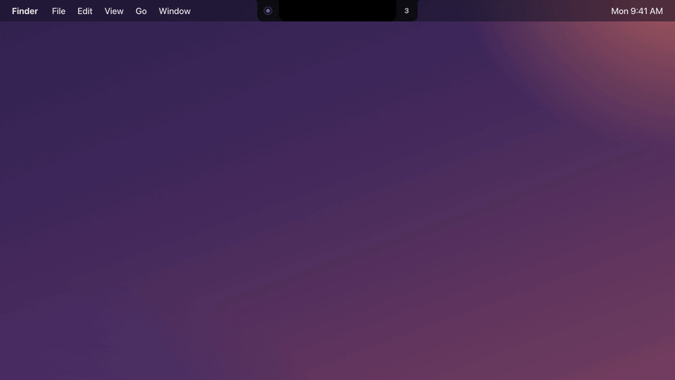
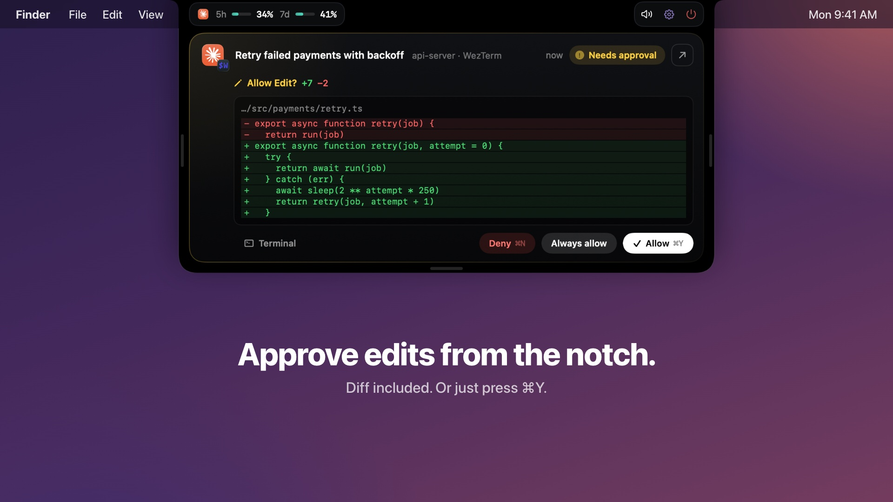
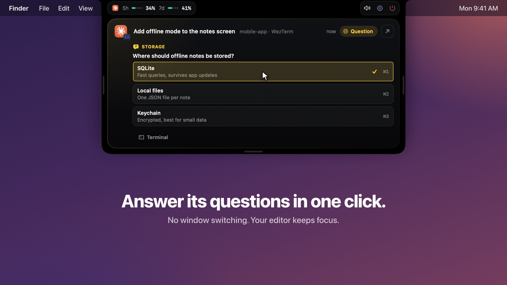
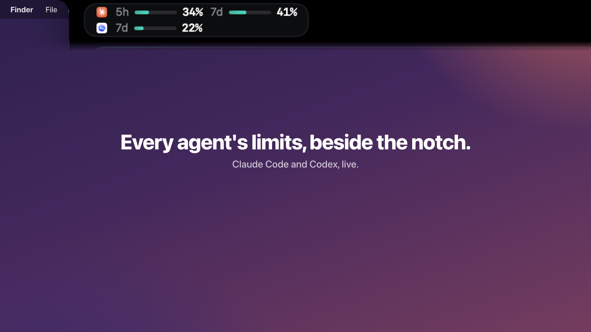

# Notch Island

**A Dynamic Island for your coding agents.**
Watch every Claude Code, Codex, Cursor, Gemini CLI, GitHub Copilot CLI and OpenCode session from your Mac's notch, approve tool calls with one click, and jump straight back to the right terminal pane.

Free, open source, fully local: no account, no server, no network calls, no telemetry.

[](docs/demo.mp4)

▶ **[Watch the 80-second demo](docs/demo.mp4)** (with sound): three agents at once, approvals with diffs, questions, plan limits, Settings, jumping back to the pane, and a real install.


## Features

- **Every session at a glance.** Each running agent gets a card with its title, your last prompt, the tool it is running right now and its last reply. Five cards show at once; the rest scroll.
- **Approve from the notch.** When an agent asks for permission, the island opens with the exact command and four buttons: Allow, Always allow, Deny, or Terminal (answer it in the terminal instead). File edits show a diff of the changed lines with +/− counts.
- **Answer questions.** When Claude asks a question with options, click one to answer it from the notch.
- **Keyboard shortcuts.** While a request waits: ⌘Y allows, ⌘N denies, ⌘1-⌘4 pick an answer. The keys are only taken while something waits, so they work as usual the rest of the time.
- **Jump back.** Click a card to bring its terminal forward, down to the exact pane in WezTerm and tmux; any other terminal or editor is brought to the front.
- **Plan usage.** Beside the notch, each agent in use shows its limits next to its icon: Claude's 5-hour and 7-day windows (Pro and Max plans) and Codex's own windows.
- **Resizable.** Drag the island's sides to make it wider or narrower, or its bottom edge to show more or fewer cards; the pointer changes on the edge. Double-click an edge to reset.
- **Status in the notch.** Closed, the notch shows a pulsing dot while agents work, a check when they finish and an amber count when one needs you.
- **Opens on hover.** Rest the pointer on the notch and it opens; move away and it closes again (unless an approval is waiting).
- **Sounds.** A different system sound for each event: a session starts (Pop), needs you (Funk), finishes (Glass), fails (Basso), hits a rate limit or passes 90% plan usage (Sosumi), or ends (Bottle). Each has its own switch in Settings; the speaker button mutes them all. To use your own sound, put a file named after the event (`start`, `needsYou`, `done`, `failed`, `limit` or `end`, as `.aiff`, `.wav`, `.mp3`, `.m4a` or `.caf`) in `~/.notch-island/sounds/`.
- **Settings.** The gear in the header switches each agent on or off and controls hover, auto-open for approvals, approving from the notch, plan usage and each sound.
- **Survives restarts.** Quit it, reboot, reinstall: on launch it finds the Claude sessions that are already running.


## In pictures

| Approve an edit, with its diff | Answer a question in one click | Every agent's limits |
|---|---|---|
|  |  |  |

All screenshots and the video use made-up sessions.

## Supported agents

| Agent | Sessions and live status | Approvals from the notch | How it connects |
|---|---|---|---|
| Claude Code | Yes, with Claude's own session titles | Yes, including "Always allow" | Hooks in `~/.claude/settings.json` |
| Codex | Yes, from the CLI and the Codex app | Yes | Hooks in `~/.codex/hooks.json` |
| Cursor | Yes, the Cursor app's agent and `cursor-agent` | No; you approve in Cursor | Hooks in `~/.cursor/hooks.json` |
| Gemini CLI | Yes, with its replies | Shows when it needs you, with what it asks; you answer in Gemini CLI | Hooks in `~/.gemini/settings.json` |
| GitHub Copilot CLI | Yes, with its replies | Shows when it needs you, with what it asks; you answer in Copilot CLI | Its own file, `~/.copilot/hooks/notch-island.json` |
| OpenCode | Yes, with OpenCode's own session titles | Shows when it needs you; you answer in OpenCode | Plugin in `~/.config/opencode/plugins/` |

The installer offers every agent it finds on your Mac and skips the rest.
Cursor, Gemini CLI and Copilot CLI have no hook that can safely wait for your answer, so their approvals stay in their own prompts: the card turns amber and tells you what is waiting (Cursor does not report its prompts, so its card stays on what it is working on).
Gemini CLI no longer accepts personal Google sign-in; it works with a Gemini API key or Vertex AI.

## Install

Requirements: macOS 14 or later and the Xcode Command Line Tools (`xcode-select --install`). Full Xcode is not needed.
No notch? It works the same, as a small bar at the top centre of the screen.

```sh
git clone https://github.com/MANISH007700/notch-island.git
cd notch-island
./install.sh
```

```
Notch Island
  ✓ Built from source
  ✓ Installed to ~/Applications/Notch Island.app
  ✓ Claude Code connected
  Connect Claude Code? [Y/n]
  ✓ Claude Code connected
  Connect Codex? [Y/n]
  ✓ Codex connected  (first time: open Codex, run /hooks and approve the Notch Island entries)
  ...
  ✓ Gemini CLI connected
  ✓ GitHub Copilot CLI connected
  ✓ Cursor connected
  ✓ Running, and starts at login
```

The installer builds the app from source, puts it in `~/Applications/Notch Island.app`, connects your agents and starts it at login.
It asks about each agent it finds (Enter means yes); answer `n` to leave one out, and run it again later to change your mind: an agent you say no to is disconnected.
To choose without questions, name the agents: `NOTCH_ISLAND_AGENTS="claude cursor gemini" ./install.sh` (ids: `claude`, `codex`, `opencode`, `gemini`, `copilot`, `cursor`).
Run without a terminal (from a script), it connects every agent it finds.
It saves an untouched copy of each config it edits next to the original, ending in `.bak-notch-island`.
To update, run `git pull && ./install.sh`; your settings are kept.

**Codex only:** Codex asks you to review new hooks once. Open Codex, run `/hooks` and approve the Notch Island entries.

## Use it

- **Hover or click the notch** to open the island; move away or click anywhere else to close it.
- **Click a card**, or its ↗ button, to jump to that session's terminal.
- **Hover a card** and click ✕ to hide it; it comes back when that session does something new.
- When a session needs you, the island opens by itself:
  - **Allow** (⌘Y) runs the tool once. File edits show their diff first.
  - **Always allow** runs it and adds the rule the agent suggested, like "don't ask again" in Claude Code.
  - **Deny** (⌘N) refuses it.
  - **Terminal** leaves the question to the agent's own prompt.
  - **A question** from the agent lists its options: click one, or press ⌘1-⌘4, and the agent carries on with that answer.
- **Resize** by dragging the island's sides (width) or bottom edge (how many cards show); double-click an edge to reset.
- In the header, the left side shows each agent's plan limits; on the right, the speaker mutes all sounds, the gear opens Settings, and the power button quits the app (it starts again at your next login).
- **Settings** switches each agent on or off and controls hover, auto-open, approving from the notch, plan usage, keyboard shortcuts and each sound.

## How it works

```
 Claude Code ─┐
 Codex ───────┤  hooks
 Cursor ──────┤
 Gemini CLI ──┼──────────▶ notch-island-hook ──JSON line──▶ ~/.notch-island/run/island.sock ──▶ Notch Island.app
 Copilot CLI ─┤                    ▲                                                              │
 OpenCode ────┘  plugin            └──────────────── your Allow / Deny, as one JSON line ◀────────┘
```

- Each agent runs a tiny hook program on its events: session start, prompt, tool use, permission request, stop.
- The hook adds which terminal and pane the agent runs in, then hands the event to the app over a local Unix socket.
- Cursor, Gemini CLI and Copilot CLI each send their own kind of event; the hook translates them into Claude Code's shape first (`Sources/Shared/Agents.swift`), so the app treats every agent the same way.
  Their replies, where an event leaves them out, are read from the agent's own session log.
- Only permission requests wait for an answer. Every other event is fire and forget, so your agents never slow down.
- Your click goes back to the waiting hook as one line (allow, always, deny, or the picked answers), and the hook hands it to the agent in the agent's own hook format.
- If the app is not running, the hook exits instantly with no output and the agent behaves exactly as if Notch Island were not installed.
- Claude plan usage comes from the data Claude Code already passes to your status line; the installer adds a `tee` in front of your status line command to save a copy.
- Codex plan usage is read from the `rate_limits` Codex already writes into its session logs in `~/.codex/sessions/`.
- Agent icons are read from the apps installed on your Mac (Claude, Codex, Cursor). An agent with no app to borrow from (Gemini CLI, Copilot CLI) shows its mark from [Simple Icons](https://simpleicons.org) (CC0) on its colours; the marks belong to their owners and only label whose card it is.
- On launch the app reads Claude Code's own records of running sessions in `~/.claude/sessions/`, so nothing is lost when it restarts.

## Uninstall

```sh
./install.sh uninstall
```

This removes the app, the login item, the OpenCode plugin, the Copilot hook file and Notch Island's hook entries in every agent's config.
Everything else in your configs stays as it is.

## Development

```sh
./check.sh               # build with warnings as errors, then test the logic, the hook protocol and the installer
./docs/screenshots.sh    # regenerate the README images from made-up sessions
```

`check.sh` never touches the running app or your real configs: it runs against a fake app on a private socket and edits copies.

To see every state in the real notch (for screenshots or a demo), run one made-up session per terminal tab:

```sh
python3 docs/demo_sessions.py approval   # an edit waiting, with a diff
python3 docs/demo_sessions.py question   # a question with three options
python3 docs/demo_sessions.py working    # Codex running a command
python3 docs/demo_sessions.py done       # OpenCode finished
```

Close a tab to remove its session.

To watch the app while you work on it, stop the login copy and run a debug build:

```sh
launchctl bootout gui/$(id -u)/local.notch-island
NOTCH_ISLAND_DEBUG=1 ~/Applications/Notch\ Island.app/Contents/MacOS/NotchIsland
```

In debug mode `kill -USR1` toggles the island, `kill -USR2` allows the newest request from a session whose id starts with `debug-` (never a real one), and both save `~/.notch-island/run/snapshot.png`.

```
Sources/Hook/        the hook every agent calls
Sources/App/         the menu bar app (SwiftUI)
Sources/Shared/      socket and process helpers, and the agent translations, used by both
integrations/        the OpenCode plugin
Tests/ + check.sh    logic, protocol and installer checks
docs/                screenshot tooling, images, the demo video and demo sessions
```

## Troubleshooting

- **Nothing shows up.** Check the app is running: `launchctl print gui/$(id -u)/local.notch-island | grep state`. Sessions that started before you installed appear on their next event (Claude Code sessions appear right away).
- **Codex sessions do not appear.** Approve the hooks once with `/hooks` in Codex.
- **Gemini CLI sessions do not appear.** Run `/hooks` in Gemini CLI and check the Notch Island hooks are enabled.
- **An agent's sessions never show.** Check that agent is switched on under Settings → Agents.
- **No usage numbers.** Claude Code only sends them on Pro and Max plans, after the first reply of a session.
- **Jump only brings the app forward.** Pane-level jumping works for WezTerm and tmux; other terminals are activated as a whole.

## License

MIT. See [LICENSE](LICENSE).
